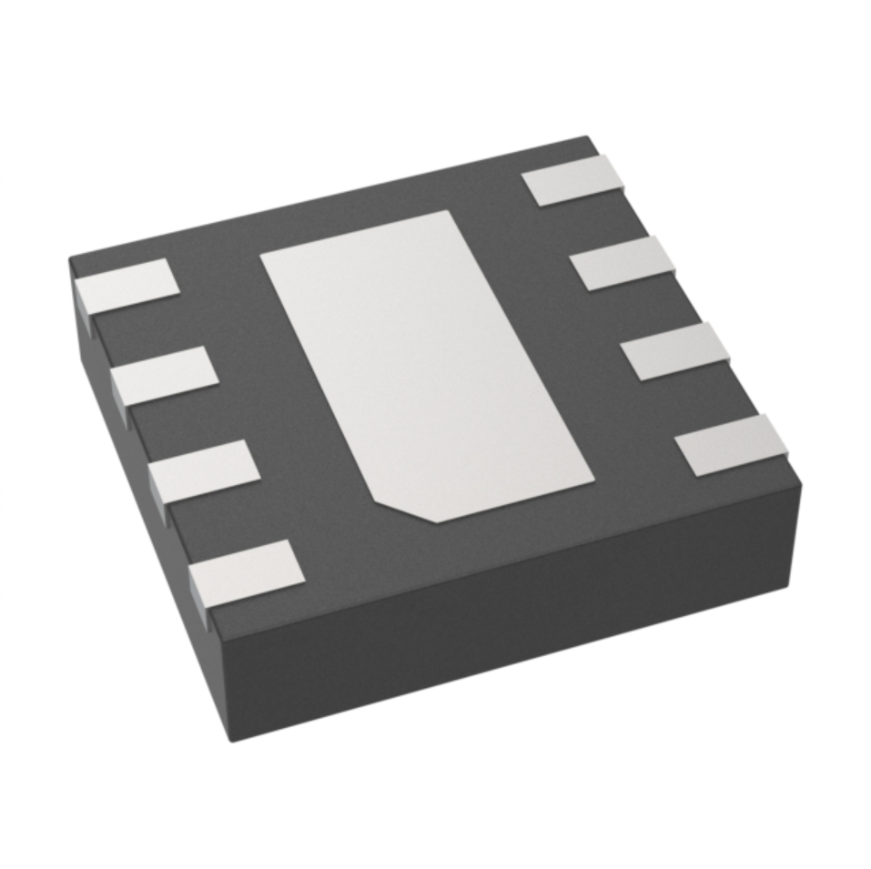

*Table 1: Light Sensor*

**Ambient light module**

1. BU27030NUC-E2 surface mount Ambient,IR

    

    * $0.074/each unit
    * [Link to product](https://www.digikey.com/en/products/detail/rohm-semiconductor/BU27030NUC-E2/13919381)

    | Pros                                      | Cons                                                             |
    | ----------------------------------------- | ---------------------------------------------------------------- |
    | Inexpensive                               | not a full RGB color sensor |
    | direct PCB heat sinking                  | No distance sensing                                        |
    | Meets surface mount constraint of project |

2. APDS-9251-001 surface mount Ambient,IR

    

    * $1.83/each
    * [Link to product](https://www.digikey.com/en/products/detail/broadcom-limited/APDS-9251-001/10135043)

    | Pros                                                              | Cons                |
    | ----------------------------------------------------------------- | ------------------- |
    | digital output simplifies connection to microcontroller                                             | difficult to solder      |
    | no analog-digital converter needed                                 | No built in proximity detection|
    | small size |

3. OPT3004DTST Surface mount Ambeint,IR
    

    * $1.97/each unit
    * [Link to product](https://www.digikey.com/en/products/detail/texas-instruments/OPT3004DTST/15926658)

     | Pros                                      | Cons                                                             |
    | ----------------------------------------- | ---------------------------------------------------------------- |
    | reduced inteference with infrared light sources                              | needs careful placement |
    | designed to match the human eye                  | small package making diffciult to solder                                       |
    | compact design |

**Choice:** Option 2: APDS-9251-001 surface mount Ambient,IR

**Rationale:** This ambient IR sensor is the best option because it can measure RGB and infrared light. Its best for dtetcting lighting conditions and color temperature; its not exclusive to level of brightness. It's small and compact, although it's hard to solder it doesnt take up much PCB space.
