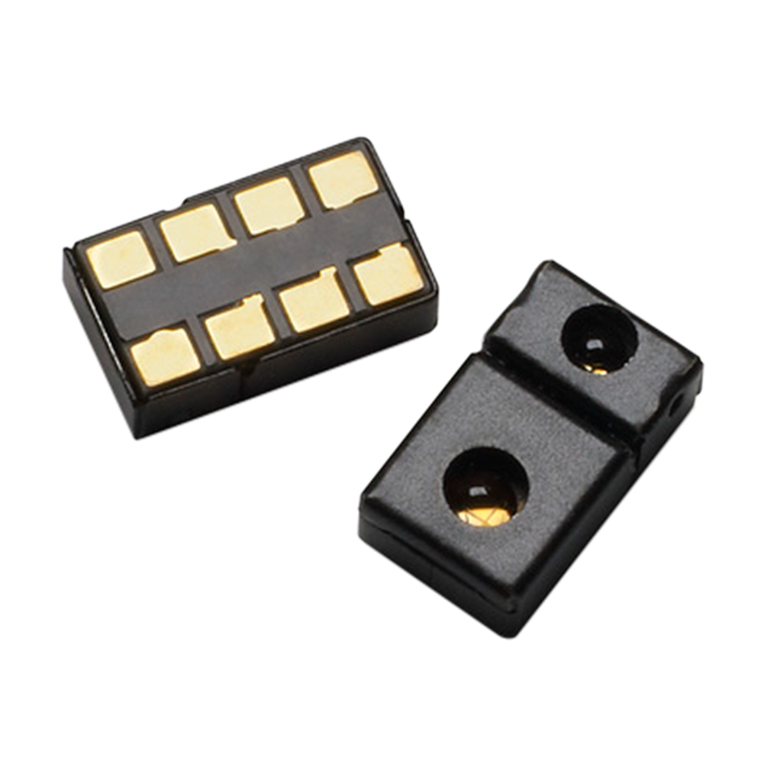
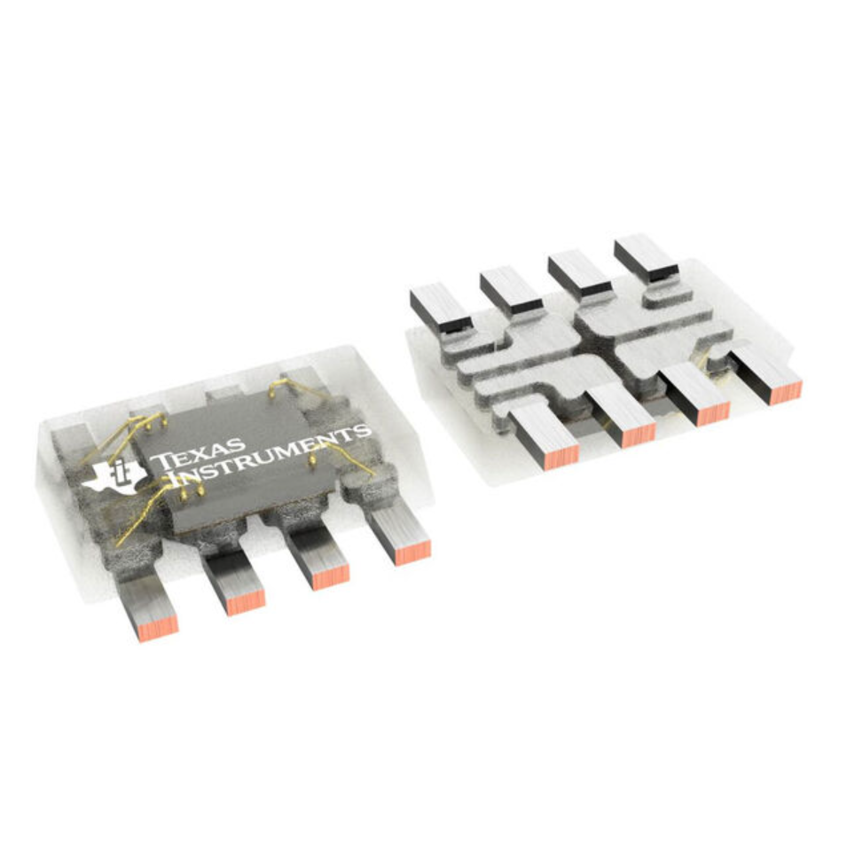
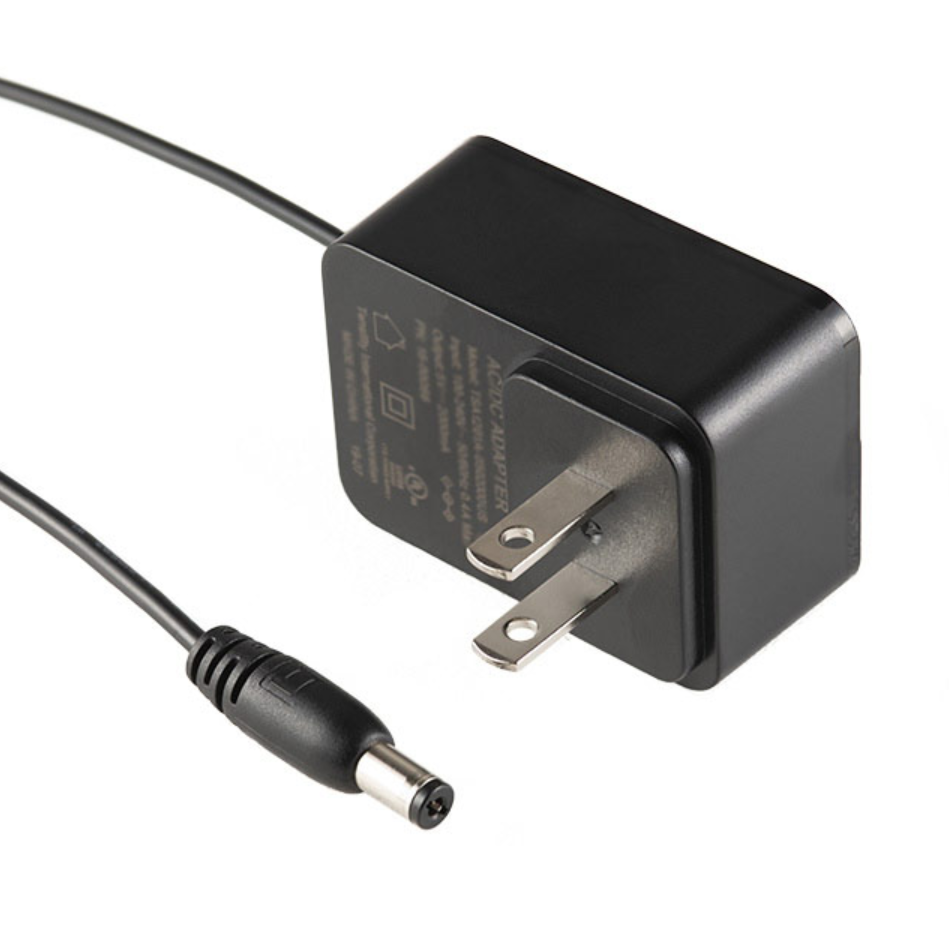
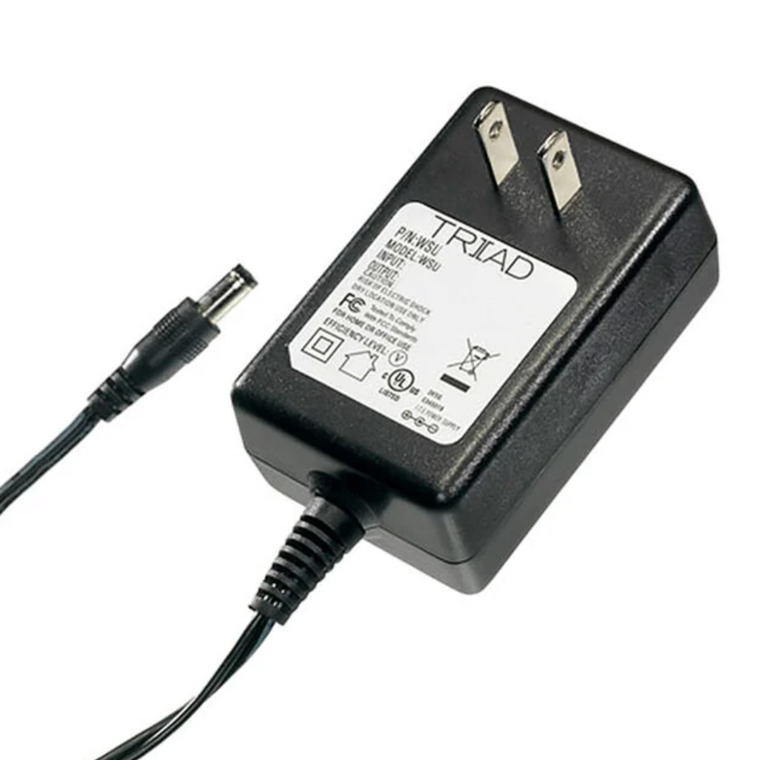

*Table 1: Light Sensor*

**Ambient light module**

1. BU27030NUC-E2 surface mount Ambient,IR

    

    * $0.074/each unit
    * [Link to product](https://www.digikey.com/en/products/detail/rohm-semiconductor/BU27030NUC-E2/13919381)

    | Pros                                      | Cons                                                             |
    | ----------------------------------------- | ---------------------------------------------------------------- |
    | Inexpensive                               | not a full RGB color sensor |
    | direct PCB heat sinking                  | No distance sensing                                        |
    | Meets surface mount constraint of project |

2. APDS-9251-001 surface mount Ambient,IR

    

    * $1.83/each
    * [Link to product](https://www.digikey.com/en/products/detail/broadcom-limited/APDS-9251-001/10135043)

    | Pros                                                              | Cons                |
    | ----------------------------------------------------------------- | ------------------- |
    | digital output simplifies connection to microcontroller                                             | difficult to solder      |
    | no analog-digital converter needed                                 | No built in proximity detection|
    | small size |

3. OPT3004DTST Surface mount Ambeint,IR
    

    * $1.97/each unit
    * [Link to product](https://www.digikey.com/en/products/detail/texas-instruments/OPT3004DTST/15926658)

     | Pros                                      | Cons                                                             |
    | ----------------------------------------- | ---------------------------------------------------------------- |
    | reduced inteference with infrared light sources                              | needs careful placement |
    | designed to match the human eye                  | small package making diffciult to solder                                       |
    | compact design |

**Choice:** Option 2: APDS-9251-001 surface mount Ambient,IR

**Rationale:** This ambient IR sensor is the best option because it can measure RGB and infrared light. Its best for dtetcting lighting conditions and color temperature; its not exclusive to level of brightness. It's small and compact, although it's hard to solder it doesnt take up much PCB space.

*Table 2: power supply*
**Power supply module**

1. 16-00078 AC DC, adapter
    

   *$7.51/each unit
   
   *[Link to product](https://www.digikey.com/en/products/detail/tensility/16-00078/10324417)
     
    | Pros                                      | Cons                                                             |
    | ----------------------------------------- | ---------------------------------------------------------------- |
    |compact design                             | fixed connector that may need adapter|
    |affordable                                 | limited current|   

 2. WSU120-0700 AC DC, adapter
    

   *$7.58/each unit
   
   *[Link to product](https://www.digikey.com/en/products/detail/triad-magnetics/WSU120-0700/3094979)

   | Pros                                      | Cons                                                             |
   | ----------------------------------------- | ---------------------------------------------------------------- |
   |long power cable                           | low current capacity|
   |suitable for low power electronics         | larger dimensions|   
    
 3. WSU120-0700 AC DC, adapter
    

   *$7.90/each unit
   
   *[Link to product](https://www.digikey.com/en/products/detail/triad-magnetics/WSU090-1300/3094977)

| Pros                                      | Cons                                                             |
| ----------------------------------------- | ---------------------------------------------------------------- |
|higher maximum current output              | slightly more expensive|
|wider AC input voltage range               | larger dimensions|   

**Choice:** Option 2: WSU120-0700 AC DC, adapter

**Rationale:** Its most suitable for this projects need. The light sensor portion will not need more than 9V to operate and it has an appropiate amount for max current. 
 
