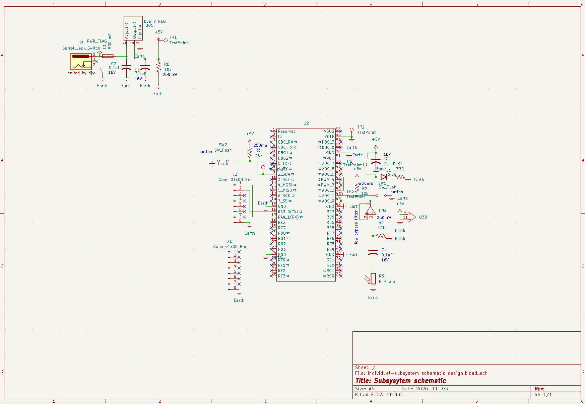

## Overview

This schematic is design to support the ambient light sensor portion of the the teams dorm hub

**Figure 01:** This shows the light sensor schematic

## Resources

The schematic as a PDF download is available [*here*](blockdiagram.png), and the Zip folder of the project [*here*](individual-subsystem%20schematic%20design.zip).
