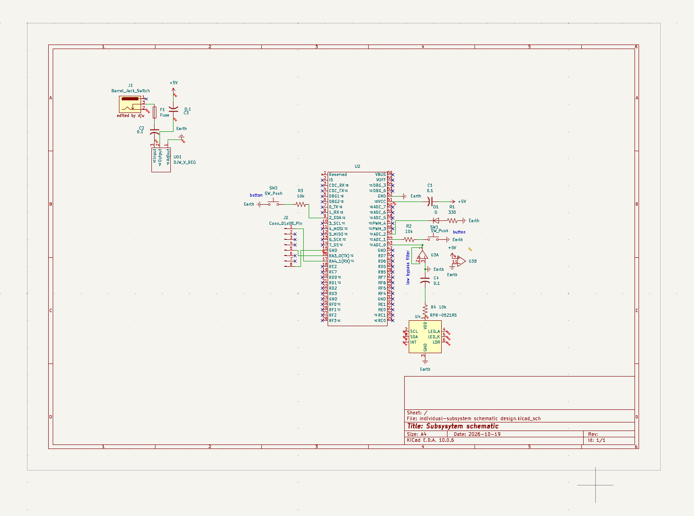

## Overview

This schematic is design to support the ambient light sensor portion of the the teams dorm hub

{style width:"350" height:"300;"}
**Figure ##:** Showing a example schematic.

## Resources

The schematic as a PDF download is available [*here*](schematic.png), and the Zip folder of the project [*here*](individual-subsystem%20schematic%20design.zip).
