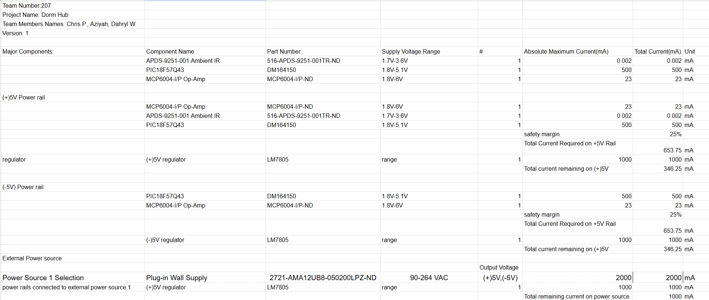

## Overview
The first power budget is for the op-amp, microcontroller, and light sensor to see how the power will be distributed.

## Conclusions

From the prepare Power Budget, .....

## Resouces

The power budget as a PDF download is available [*here*](BOM.png), and a Microsoft Excel Sheet [*here*]([PowerBudgetExample.xlsx](https://docs.google.com/spreadsheets/d/13UFAHRLLHdFtgKMYf6OYolo85ibs_NJcFvounW_eLSI/edit?usp=sharing])
