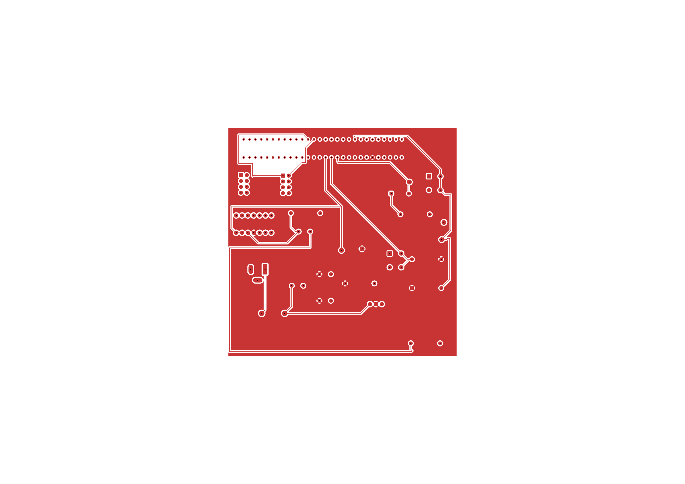
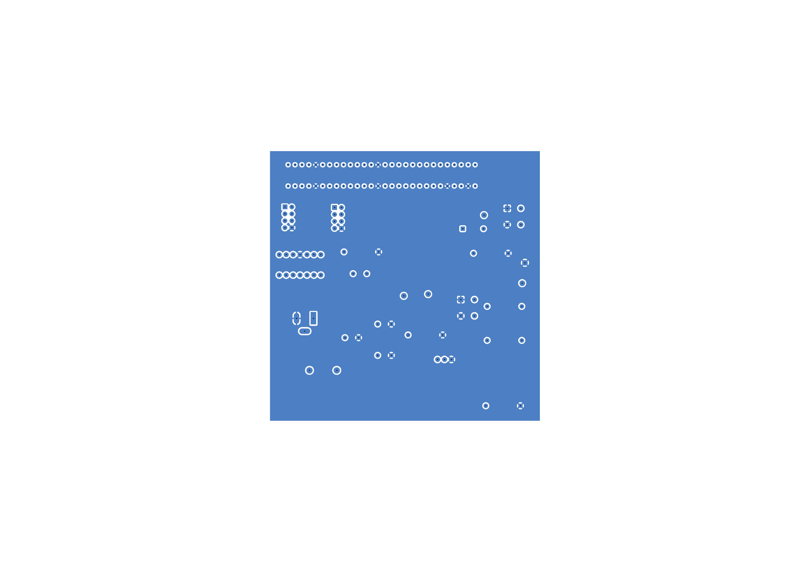

## Overview

This is the PCB design to support the ambient light sensor portion of the the teams dorm hub

**Figure 01:** This shows the front light sensor PCB design

**Figure 02:** This shows the back light sensor PCB Design

## Resources

The front and back PCB as PDF downloads are available [*here*](front.pdf) and [*here*](back.pdf). The Zip folder of the project [*here*](individual-subsystem%20schematic%20design.zip).
